# FishMarket AI (v2)

> **v2 adds:** 13 operation types, 5 question types (sell or hold, buy now or wait, best months, compare markets, best buyer type),
> an optional free-text "about you" box, retail/market/quality/input-cost data, multi-species runs (up to 3), and a dataset of
> 8 regions, 35 species, 24 markets. See `CHANGE_PROMPT.md` for the full spec this was built from.
> Run `pytest` (about 540 tests) and `python -m evals.run_golden --mode fake` (53 of 53 goldens, free).

## Agents, handoffs and shared state

The pipeline (`src/fishmarket/pipeline.py`) is the coordinator. Python runs the eight steps in a fixed order, and each
model sees only what the step before it passed the checks with. An agent never calls another agent.

```mermaid
flowchart LR
    U[User profile] --> P[Python: validate profile and load sources]
    P --> A1[Planner: choose approved sources]
    A1 --> G[Python: verify source rows and freshness]
    G -->|usable data and flags| X[Python: calculate statistics and direction]
    X --> A2[Analyst: explain checked statistics]
    A2 --> V[Python: ground claims]
    V -->|failed check, one retry| A2
    V -->|verified claims| S[Summary writer]
    V -->|retry still fails| F[Python: cautious answer]
    F --> S
    S --> R[Python: assemble report and caveats]
```



There is **no separate Data Collection or Quality Analysis agent** in this MVP. Python loads the configured files,
checks dates, units and row quality, excludes unusable sources, and calculates the statistics. The analyst receives
checked statistics and flags, not raw market tables; recorded quality information is reported as evidence and does not
change the price direction or confidence. The separate NOAA handoff experiment below is not wired into this eight-step
scenario pipeline.

| Step | Who | Receives | Hands on | If it fails |
|---|---|---|---|---|
| 1. Profile | Python | the user's form and optional note | a checked profile; the note cleaned and scanned | invalid profile: the run stops with the reason |
| 2. Planner (`agent1`) | Claude | the profile and the registry's `covers` text, never the note | a source plan | the plan check rejects it, one retry, then the default plan |
| 3. Gate | Python | every planned source | usable sources plus flags (stale, missing, duplicates, outliers, conflicts) | a source that is stale, undated or broken is excluded and named |
| 4. Analytics | Python | usable sources only | numbered statistics and the decision rule's direction | too few clean months: hard failure, no recommendation |
| 5. Analyst (`agent2`) | Claude | the statistics, trust rating, flags and note | claims that cite statistic ids | see step 6 |
| 6. Grounding | Python | the analyst's answer | the answer, only if the grounding rules pass (G1 to G8; G4 retired) | one retry with the violations, then the fixed cautious answer |
| 7. Writer (`summary`) | Claude | the checked claims | a short summary | any unchecked number or advice wording: the template summary |
| 8. Report | Python | everything above | the report, caveats and trust rating | (no model involved) |

The **researcher** is a fourth, optional agent. It is off by default, and only it may search the web. Trusted sites come
first, it has a cap of 3 searches, and Python keeps only the quoted text and links.

**What each agent may do** is fixed in `src/fishmarket/permissions.py`. The wrapper (`llm.py`) checks it before every
request, so a prompt cannot widen it. Each agent has one answer tool of its own, an output-token ceiling, a call cap and a
per-call cost cap. Only the researcher has the web. An unknown agent, another agent's tool, or a missing site list is
refused before anything is sent (`tests/test_submission_checks.py`, `tests/test_web_research.py`).

**Shared state** is kept small, and only Python writes it:
* `RunCtx` (one per run): run id, spend, call counts, cache keys and the per-agent permission counters.
* The trace: one event per step, with what was passed on. The raw note is never written to it.
* `ledger.jsonl`: every paid call. The spend guard reads it ($0.25 per run, hard stop at $34).
* `cache/`: saved model answers, keyed by prompt version, used by `replay` and `auto`.
* Read-only inputs: `fishmarket_data/` (fictional), `noaa_landings_full.csv` and the optional GBIF `lake/`.
  Raw GBIF downloads are not in this repository; see `external_data/README.md` for why and how to fetch them.

This is run coordination and audit state, not a shared database that agents can edit. Missing or invalid profile data
stops the run with a validation error. Stale, undated or otherwise unusable sources are excluded and flagged; if no
planned source passes, the pipeline may use explicitly labelled sample data at low confidence, or return an
insufficient-data result if no usable fallback exists. It never treats a stale price as current. Invalid model plans
are retried once and then replaced by a checked Python default; ungrounded analysis is retried once and then replaced
with a cautious rule-based answer. A failed summary check uses a fixed template.

## Design decisions (from the PRD review)

**Adopted:** quality and freshness as first-class data with verification status; market comparison with normalised units,
currency, fees and freight; dated, unit-labelled prices; fixed escalation sentences when data or quality cannot be verified;
labelled history; the PRD's pink salmon and caviar-buyer needs as real questions; the blast-radius table below as the safety case.

**Excluded from the MVP, on purpose:**
1. A Coordinator plus Data Collection, Price Analysis and Quality Analysis agents. That is 4 to 5 paid agents; Python already
   collects, analyses and validates, so the pipeline is the coordinator and the budget holds.
2. The four HTTP "Internal API" tools. They were proposed contracts, not services.
3. "Best food for healthy caviar" (feed science): no data, and bad advice could harm a farm. Only feed *cost* pressure is shown.
4. Telling a user fish is safe or suitable for sale. Quality is reported only as recorded.
5. Tracking user feedback or business records for the success metrics (not possible with fictional data).
6. A "new locality materials list" (no equipment data).
7. Real-time data or external-API retries (data is fixed and local).

## How the new pieces work

* **Operations** come from `registry/operation_types.csv`; each sets valid species, price channel (first sale, wholesale or retail), allowed questions and cost types. Nothing about regions, operations or segments is hard-coded.
* **Question rules** (Python decides, models explain): see `fishmarket_data/README.md`.
* **Free-text note** (`src/fishmarket/note.py`): cleaned, scanned (`untrusted_text_ignored`, `note_out_of_scope`, `profile_conflict`), passed only to the analyst and summary agents inside `<user_note>` tags, never to the planner. It never changes a number, direction, rating or tag. Instruction-like text copied by a model fails grounding (G8). The raw note is not written to traces, saved runs or the ledger.
* **Driver tags** are derived by Python; the model is no longer asked for them (the live runs showed it could add a wrong one). Thresholds are citable `rule_` rows in the statistics table.
* **Retail prices** are reported but not cross-checked against trade prices (consumer prices swing less).
* **Overrides** are keyed by planted case id; cases that replace several files (market stale) apply together.
* Safety case: stale or unverified data is flagged, never silently used; quality never changes the price direction or the confidence; no guarantees of profit or safety.

## NOAA annual handoff experiment

`src/fishmarket/handoff.py` is a separate, local proof of concept for transferring an official NOAA Fisheries
Commercial Landings Query export from a Python collector to a validated analyst consumer. It handles the export's
leading blank row and actual columns (`Year`, `State`, `NMFS Name`, `Pounds`, `Dollars`, `Confidentiality`,
`Collection`, and `Source`), filters to public commercial rows for the requested species and state, calculates
USD/lb from dollars divided by pounds, and uses Pydantic to reject empty, duplicate, inconsistent, or incomplete
handoffs. The caller can list expected years when a complete period range is required.

The local `FOSS_landings.csv` used to verify this flow contained one public 2022 Louisiana brown-shrimp row:
11,873,802 lb and $15,741,883, or about $1.3258/lb. That supports a transfer/calculation test only; a single
annual observation cannot establish a trend or support a sell/hold recommendation. The main eight-step demo
pipeline still uses its separate fictional fixture. No NOAA file is bundled in the repository.

## Real data mode (new)

The app now has four pages: **Introduction**, **Real NOAA data**, **Scenario demo (fictional)** and **Data sources**.

* Real NOAA data reads `noaa_landings_full.csv` (NOAA FOSS commercial landings, 1950-2024). Recreational (MRIP) rows, withheld-for-confidentiality rows and rows with implausible prices (outside $0.02-$60/lb, usually unit problems) are dropped and counted on screen. Code: `src/fishmarket/real_data.py`.
* This data is **annual and dockside only**. It supports price trend, year-to-year swings, volume trend and which region paid most. It cannot support monthly timing, market comparison, quality or cost questions; those remain in the fictional demo and are always labelled fictional.
* `src/fishmarket/tools.py` holds the four read-only tools from the PRD: `get_fish_prices`, `get_fish_quality`, `compare_market_price`, `validate_market_data`.
* `src/fishmarket/contracts.py` is a stage-handoff contract: a FLAGGED record needs `flag_reason` and `required_action` and can never feed a confirmed analysis.
* `src/fishmarket/sources.py` lists every source and its honest status. NOAA trade, FishBase and GBIF have fetch scripts (`scripts/fetch_noaa_trade.py`, `scripts/fetch_species_info.py`) that were **written but not run against the live services**. The Vessel Registry and AFSC Survey links supplied were only `noaa.gov`, so they need real dataset URLs.
* Refresh the landings: `python scripts/extract_noaa_full.py`.

PRD safety case 3 (all price data removed plus an injected note) is now a test in `tests/test_note.py`.

### Real-data upgrades
* **Inflation:** `data_real/cpi_u_annual.csv` (BLS CPI-U). Charts show price as reported and in latest-year dollars; lobster is about 4.0% a year as reported but about 0.4% after inflation.
* **State drill-down and concentration:** 33 states, with each state's share of landings.
* **Browse the market:** top species by value or pounds, and biggest price movers.
* **Recreational vs commercial:** NOAA MRIP pounds against commercial pounds (1980 on; no recreational prices exist).
* **Interpretation flags:** price/landings patterns are described as possible supply or demand effects, never asserted.
* **AI summary:** `src/fishmarket/real_summary.py`. Python writes the claims; the AI may only reword them. Any number not in the claims, or any advice or prediction wording, is rejected and the template text is shown instead.

### Validation gates and the 60% / 40% finding (new)
`src/fishmarket/cleansing.py` classifies every NOAA row as VALID, REVIEW, REJECTED or EXCLUDED_BY_DESIGN with reason codes (`python fishmarket_pipeline.py --no-api`).
The earlier "60% valid, 40% rejected" came from treating recreational rows (NOAA publishes them without dollars) and zero-fill placeholder rows as errors.
With them separated: 189,388 valid, 34,842 not errors by design, 4,029 rejected (zero dollars, withheld species, zero pounds with dollars and similar), 1,569 held for review (price more than 20x away from the species norm). Pass rate on rows that should have values: 97.1%.
`src/fishmarket/validators.py` gates the other sources the same way (GBIF match and coordinates, FishBase response shape, NOAA trade rows, and each species/region series before analysis). A FLAGGED result stops the analysis and states the reason and the action to take.
GBIF and FishBase are queried by scientific name (`ts_scientific_name`), never by NOAA's common-name format.

---

# FishMarket AI (demo)

A multi-agent marketing assistant for fishers, co-ops, distributors and fish farmers. It answers one question,
"sell now or hold for the next three months?", from **fictional** price and volume data. Eight pipeline steps,
**three paid AI agents** (retrieval planner, analyst, summary writer) and Python checks between them.
Every number comes from Python; the models only interpret numbered statistics, and Python re-checks them.

## Setup

```
pip install -r requirements.txt          # or: pip install -e .
export ANTHROPIC_API_KEY=...             # only needed for live calls; never commit it
```
Without installing the package, prefix commands with `PYTHONPATH=src`.

## Run

```
python -m fishmarket.cli run --preset G01 --mode fake     # free: scripted stand-in model, no key needed
python -m fishmarket.cli run --preset G01                 # auto: saved answers first, live call on a miss
python -m fishmarket.cli run --preset G06                 # preset with planted problems (conflict + stale)
streamlit run app/streamlit_app.py                        # the demo UI
pytest                                                    # free tests (about 100)
python -m evals.run_golden --mix dev --mode fake          # scoring harness, free with the scripted model
python -m evals.run_golden --mix dev --mode auto          # the real golden pass (about 3 cents expected)
```
Modes: `auto` (cache, then API), `replay` (cache only, the safe demo mode), `live` (always call), `fake` (free).
With a key in `.env`, `auto` spends money on any cache miss. In the app, set **AI mode** to **Replay** or **Offline demo**
before a demo.
Spend guard: $0.25 per run, hard stop at $34 on the ledger (`ledger.jsonl`). Prices are in `pricing.json` and are
**unverified third-party figures**: check Anthropic's pricing page and model IDs before the first live call.

## What was verified, and what was not

Verified (offline, 100+ tests): the gate on all 17 series and all five planted cases (flags and trust match the
manifest), analytics against the ground truth, grounding rules G1 to G6, trust precedence, the wrapper's cache,
replay, spend guard and secret handling (against a stubbed SDK), every retry and fallback path (never more than
5 model calls), all 12 golden profiles with the scripted model, and the Streamlit script's logic against a stand-in
for the `streamlit` module.

**Not fully verified:**
1. Live Claude calls cover preset G01 only (dev and final mixes) and part of one dev golden pass. The full live golden
   pass has not been run. Real answers break the grounding rules more often than the scripted model, which costs a retry
   or lands in the cautious answer.
2. The tool schemas were accepted by the API in those live runs; other presets have not been tried live.
3. The UI has been checked in a browser in Replay and Offline demo modes only.
4. `scripts/approve.py` has never run against real answers, so `tests/snapshots/` is empty and the six replay
   tests skip until you approve a preset. Do this after a good live run: `python scripts/approve.py G01`.
5. Agent 1 sees only the registry's `covers` text. That text does not say which regions trade press covers for cod,
   so a real planner will sometimes include `SRC-TRD-01` for Cod | Pacific Northwest. The plan check catches it and the
   retry fixes it (one extra small call). This is by design.

## First live run, cheapest order
1. `python -m fishmarket.cli run --preset G01 --mix dev` and read the trace. 2. Same for G02 to G05.
3. `python -m evals.run_golden --mix dev --mode auto --cases G01,G02,G03` (without `--mode` the pass is fake and free). 4. Fix prompts, rerun failing cases once.
5. Approve presets for replay, then `--mix final` only for the rehearsal.

## Choices that go beyond the build prompt
- `schema` is treated as a data-quality flag (Medium trust) with its own caveat sentence.
- `fake` mode, `src/fishmarket/fake_agents.py` and `StubAnthropicClient` exist so everything runs for free.
- Snapshots ignore cost, cache and token fields (replay is free by design).
- API failures (rate limit, no key, replay miss, budget) never loop: Agent 1 falls back to the default plan,
  Agent 2 to the cautious answer, the summary to the template, and the trace says so.

All data is fictional. Layout and rules: see `BUILD_PROMPT.md` and `fishmarket_data/README.md`.
